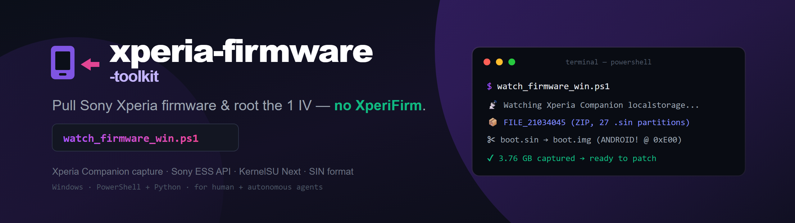

<p align="center">
  
</p>

<p align="center">
  <a href="https://github.com/nsozturk/xperia-firmware-toolkit/releases"></a>
  
  
  <a href="LICENSE"></a>
  
  <a href="AGENTS.md"></a>
  
</p>

<p align="center">
  <code>sony-xperia</code> <code>firmware</code> <code>xperia-companion</code> <code>ess-distribution-api</code>
  <code>kernelsu</code> <code>bootloader-unlock</code> <code>reverse-engineering</code> <code>android</code>
  <code>xperifirm-alternative</code> <code>windows</code>
</p>

---

**xperia-firmware-toolkit is a free, open-source Windows toolkit for pulling Sony Xperia stock firmware — straight from Xperia Companion or from Sony's own ESS distribution API — and rooting the Xperia 1 IV (XQ-CT72 / PDX223) with KernelSU Next.** It documents how Xperia Companion works internally, where it drops firmware, and how to fetch the exact same files directly, then takes you through unlock → patch → root and (bonus) adb-based data migration between phones.

> ⚠️ For your **own devices** and **security research**. Unlocking a Sony bootloader
> wipes the device and revokes DRM keys. No Sony firmware is redistributed here —
> only the method and tooling. Every device token/ID/serial in the examples is redacted.

## What it does

- **Capture firmware from Xperia Companion** — find where Companion stores firmware
  on Windows and grab the partition `.sin` bundle as it downloads.
- **Download firmware without Companion** — call Sony's public **ESS distribution
  API** directly (no MITM, no pinning bypass) and pull chunks over HTTP Range.
- **Reverse-engineering notes** — Companion's Java/OSGi internals, the JRE-truststore
  MITM trick, metadata files, and the Sony `.sin` format.
- **Root the Xperia 1 IV** — extract stock `boot.img`, patch with KernelSU Next,
  `fastboot flash boot`, then Zygisk + PlayIntegrityFix + TrickyStore.
- **Migrate Android data over adb** — contacts → vCard, SMS → restorable XML, media
  push, APK extraction and Play-Store-vs-sideload classification.

## Repository layout

| Path | What |
|------|------|
| `docs/xperia-companion-reverse-engineering.md` | How Companion works + the MITM/JRE-truststore method |
| `docs/xperia-companion-firmware-capture.md` | Where firmware lands on Windows + capture |
| `docs/sony-ess-api-direct-download.md` | The ESS API chain (Companion-less download) |
| `docs/rooting-guide.md` | Full bootloader-unlock → KernelSU Next → Zygisk/PIF/TrickyStore walkthrough |
| `firmware-capture/watch_firmware_win.ps1` | Watches Companion and copies firmware parts as they land |
| `mitm/log_urls.py`, `mitm/capture.ps1` | mitmproxy addon + transparent capture launcher |
| `data-transfer/*.ps1` | adb migration tools (contacts, SMS, media, APKs) |
| `tools/` | Bundled third-party root/ad-block/SSL-unpinning tools (see `tools/CREDITS.md`) |
| `examples/*.xml` | Redacted ESS API responses |

## Quick start

```powershell
# Capture firmware while Xperia Companion "Software repair" downloads it
powershell -ExecutionPolicy Bypass -File firmware-capture\watch_firmware_win.ps1

# Extract contacts from a source phone over adb
powershell -ExecutionPolicy Bypass -File data-transfer\contacts_to_vcf.ps1
```

Set `$Serial` and paths at the top of each script first. You need Android
platform-tools (`adb`/`fastboot`) on PATH.

## FAQ

### Do I need XperiFirm to download Sony Xperia firmware?
No. This project shows two routes that don't use XperiFirm: capturing the files
Xperia Companion downloads, and calling Sony's ESS distribution API directly.

### Where does Xperia Companion store firmware on Windows?
Under `%LOCALAPPDATA%\Sony\Xperia Companion\<InstallTime>\localstorage\<REGION>\`
as `FILE_<contentId>` (a ZIP of all partition `.sin` files). Details in the docs.

### Does rooting the Xperia 1 IV need an unlocked bootloader?
Yes — Sony bootloader unlock (which wipes the device and revokes DRM keys) is
required before flashing a patched boot image.

### How do I get a raw boot.img from a Sony `.sin` file?
Strip the SIN header up to the `ANDROID!` magic (offset 3584 on the analysed
build); the remainder is a valid boot image. See the RE notes.

### Did you have to defeat SSL pinning on Xperia Companion?
No. Companion uses standard TLS with its own JRE truststore; a trusted MITM CA
imported into `jre\lib\security\cacerts` is enough — and even that is optional
because the firmware tokens are already in `services.json`.

## Alternatives / compared with

- **XperiFirm** — enumerates and downloads all currently-available Xperia firmware
  from Sony's servers. This toolkit instead documents the Companion/ESS mechanics
  and focuses on capture + a specific root workflow; use XperiFirm for broad
  version enumeration.
- **Newflasher** — flashes Sony `.sin`/FTF firmware over the flashmode protocol.
  Complementary: use it to flash what you capture here.

## License

MIT — see [LICENSE](LICENSE). Not affiliated with Sony. "Sony" and "Xperia" are
trademarks of their respective owners; firmware is their property.
